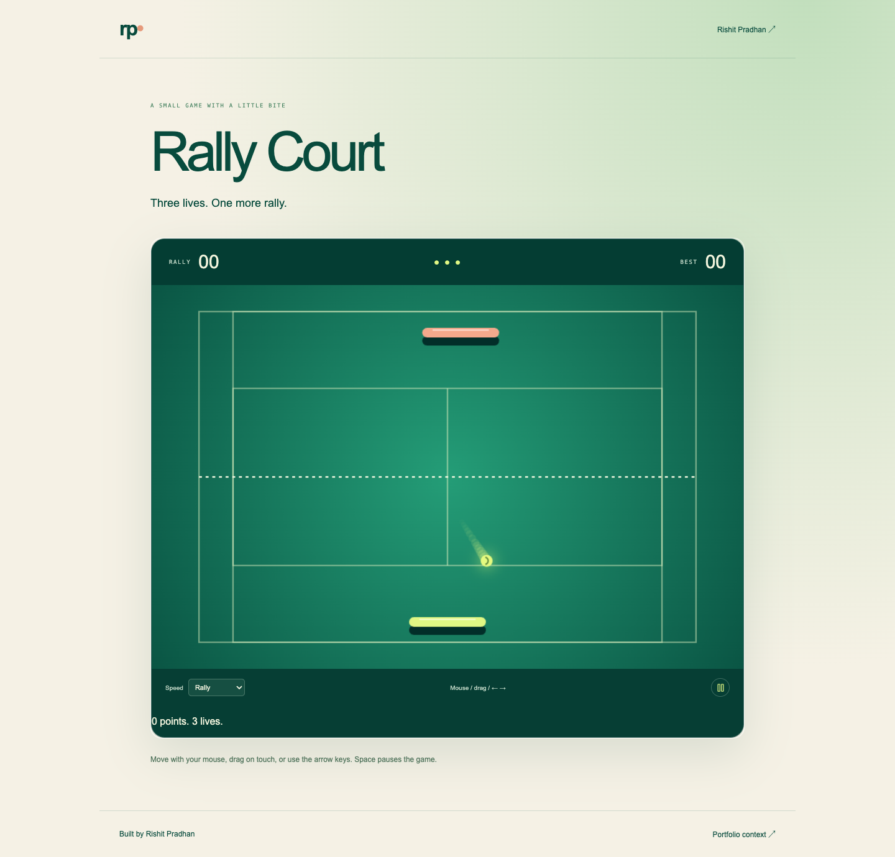

# Rally Court

**[Download & run locally](LOCAL.md)** — a short guide and ready-to-run ZIP.

A playable tennis-inspired arcade game with a small court, three lives, a returning opponent, and a reason to play one more round.

[Live portfolio preview](https://rishitpradhan.com/#offscreen) · [Rishit Pradhan](https://rishitpradhan.com)



## What works

- Mouse, touch, arrow-key, and A/D paddle control.
- Angle-dependent returns, wall rebounds, a speed-limited opponent, and increasing return speed.
- One point per return, three for a winner, three lives, and a browser-local best score.
- Pause/resume, a harder speed setting, and hidden-tab handling.

## Run locally

Requires Node.js 22.17+ and npm.

```sh
npm ci
npm run dev
```

Open the localhost URL printed by Vite.

```sh
npm test
npm run build
npm run preview
```

The build is static and outputs to `dist/`. No API key, account, or server is required. The live link above opens this experiment inside the personal portfolio; this repo runs it independently. For World Garden and Wearable Signal Lab, choose the interactive preview tab in the portfolio.

## How it is built

`src/physics.ts` owns the court state and collision rules. `src/TennisGame.tsx` draws the canvas and translates pointer or keyboard input. Physics advances using elapsed time capped at 25 ms to keep a resumed tab from teleporting the ball.

See [implementation notes](docs/architecture.md) for the model, constraints, and tradeoffs.

## Verification

Return collision and single scoring, wall reflection, missed-ball life accounting, winners, terminal game-over, and long-frame movement bounds. Run the Node test suite with `npm test`; `npm run build` also type-checks the React/TypeScript app.

## Scope

A tennis-inspired paddle game, not a realistic tennis simulator. There is one local player and a simple AI opponent; no network multiplayer.

## Origin and license

Extracted and developed as a standalone experiment from [Rishit’s portfolio](https://rishitpradhan.com). React, TypeScript, Vite, and Lucide icons. Source code is MIT licensed; dependency licenses remain their own.
